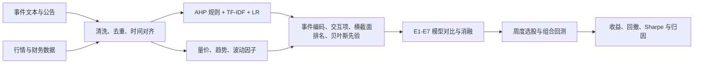
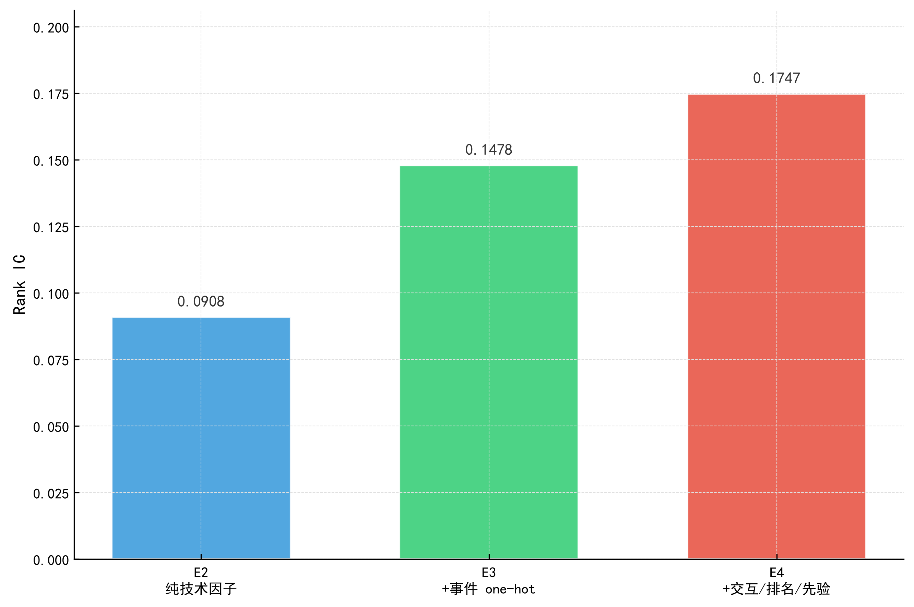
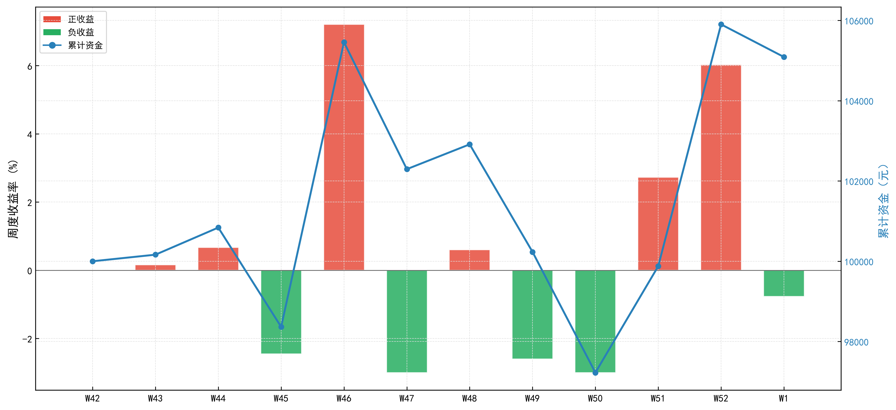
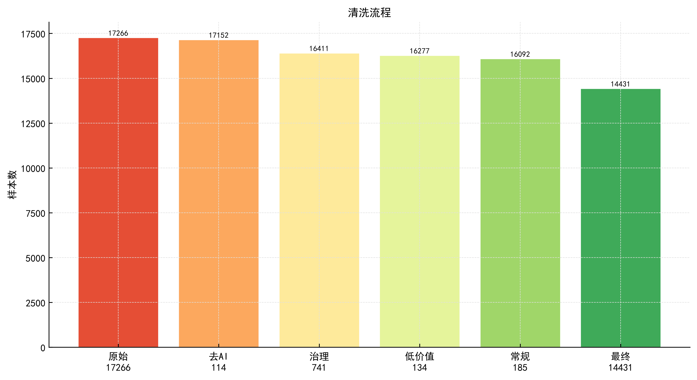
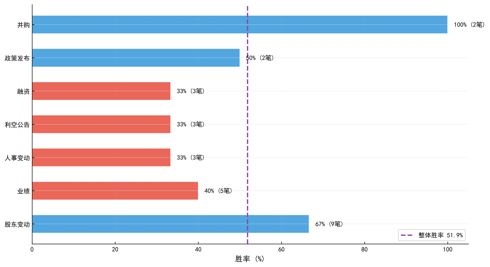

# 事件驱动 A 股策略研究

**从非结构化事件文本到可回测的选股信号：事件分类、影响预测、消融实验与组合回测。**

`Python 3.12` · `LightGBM` · `scikit-learn` · `Pandas` · `历史回测`

[](https://github.com/zhangkai333/teddy-cup-event-strategy/actions/workflows/ci.yml)

本项目基于泰迪杯事件数据，完成事件清洗与分类、事件公司关联、事件影响预测、投资组合构建和回测分析。项目的核心问题不是单纯提高分类准确率，而是验证事件信息能否为横截面选股与收益排序提供稳定增量。

> **结果边界**：仓库中的回测使用历史数据进行离线验证，不代表实时交易或实盘收益。原始数据受比赛与授权约束，不随仓库分发。

## 核心结果

| 维度 | 结果 |
| --- | --- |
| 数据规模 | 14,431 条建模样本，训练 / 验证 / 测试为 5,674 / 1,859 / 6,898 |
| 事件一级分类 | AHP 规则 + TF-IDF + LR，随机 80/20 验证集加权 F1 **97.11%** |
| 主模型 E4 | LightGBM 全特征，验证集 Rank IC **0.1747**，方向准确率 **57.34%** |
| 事件特征增益 | 加入事件 one-hot 后，Rank IC 从 0.0908 提升至 0.1478 |
| 三个月历史回测 | 累计收益 **5.09%**，沪深 300 为 0.04%，最大回撤 **-7.81%** |

分类 F1 来自随机分层 80/20 验证集，用于衡量当前标签体系内的拟合与分类能力；它不代表按时间切分的样本外泛化表现。选股增量主要由 Rank IC、方向准确率和分区间回测共同判断。

## 我的工作与 AI 协作

项目设计、数据分析路线、特征与模型方案、回测实现、结果校验和文档整理由本人完成；AI 用于提升实现与调试效率。

| 工具 | 实际用途 |
| --- | --- |
| Codex | 辅助代码生成、错误排查和局部重构 |
| DeepSeek | 辅助需求梳理、方案讨论、结果解释和文档草拟 |
| 人工校验 | 确定分析口径、运行脚本、核对指标，并删除与结果不一致的表述 |

典型工作流：

```text
明确分析目标 -> 拆解实验步骤 -> Codex 辅助实现/修复 -> 实际运行
             -> 检查日志与结果 -> 人工判断合理性 -> 更新代码与文档
```

AI 输出不被视为实验证据。README 中的关键指标均来自本地脚本运行后生成的日志或结果文件。

## 项目能力

- **数据分析**：完成缺失值、重复样本、异常公告和文本字段检查，并输出描述性统计与 27 张 EDA 图表。
- **NLP 与分类**：使用 AHP 规则结合 TF-IDF + Logistic Regression 完成事件一级分类。
- **关联挖掘**：结合事件主体、文本相似度和股票映射，构建事件与公司的关联结果。
- **预测建模**：比较事件研究法、纯技术因子、事件 one-hot、交互项、横截面排名和贝叶斯先验的增量贡献。
- **组合回测**：进行按周调仓、评分加权、最多 3 只持仓、双边交易成本和 3% 周止损的历史回测。
- **可复现交付**：通过统一入口运行训练、扩展回测、图表生成和历史数据冒烟测试。

## 技术路线



## 数据说明

原始数据不进入 Git 仓库。运行项目前，通过环境变量 `TEDDY_DATA_DIR` 指向本地数据目录：

```text
公司财务数据/
股吧评论数据/
股票行情数据/
建模核心表/
事件数据/
训练结果/          # 可选
```

数据划分如下：

| 数据集 | 样本数 | 用途 |
| --- | ---: | --- |
| 训练集 | 5,674 | 拟合 LightGBM 与事件影响模型 |
| 验证集 | 1,859 | 模型选择、指标对比与消融实验 |
| 测试集 | 6,898 | 端到端流程验证；扩展回测合并验证集与测试集，共 8,757 条 |

## 模型与消融实验

事件一级分类首先由 AHP 规则生成初始结构，再使用 TF-IDF + Logistic Regression 进行监督学习。主预测任务同时比较三分类标签和 CAR 回归排序，使用加权 F1、Rank IC 与方向准确率共同评价。

| 模型 | 特征组成 | Weighted F1 | Rank IC | 方向准确率 |
| --- | --- | ---: | ---: | ---: |
| E2 | 32 个纯技术因子 | 0.4210 | 0.0908 | 56.59% |
| E3 | E2 + 事件 one-hot | 0.4229 | 0.1478 | 56.91% |
| E4 | E3 + 交互项 + 横截面排名 + 贝叶斯先验 | **0.4286** | **0.1747** | **57.34%** |

公开结果表：[`docs/results/ablation_metrics.csv`](docs/results/ablation_metrics.csv)

核心发现：

- 事件 one-hot 对排序能力贡献最明显，将 Rank IC 提升 `0.0571`。
- 交互项、横截面排名和贝叶斯先验继续带来 `0.0268` 的 Rank IC 增益。
- 分类准确率提升有限，但排序指标改善更明显，说明事件信息更适合用于候选股票排序而不是单独预测涨跌。



## 历史回测

回测以历史样本为输入，按周持有组合，使用评分分配资金，并按双边交易成本计算净收益。以下结果用于检验分析流程，不构成投资建议。

| 区间 | 策略收益 | 沪深 300 | 超额收益 | 最大回撤 | Sharpe | 周胜率 |
| --- | ---: | ---: | ---: | ---: | ---: | ---: |
| 2025-12-08 至 2025-12-26，3 周 | 5.66% | 1.62% | 4.04% | -3.00% | 2.985 | 66.7% |
| 2025-10-01 至 2025-12-31，3 个月 | 5.09% | 0.04% | 5.05% | -7.81% | 0.932 | 50.0% |
| 2025-12-01 至 2025-12-31，单月 | 2.11% | 2.31% | -0.20% | -5.53% | 0.844 | 40.0% |

公开结果表：[`docs/results/backtest_summary.csv`](docs/results/backtest_summary.csv)。Sharpe 使用周收益率、1.5% 年化无风险利率和样本标准差，并按 52 周年化；最大回撤基于组合净值序列计算。

3 周回测的年化收益受样本期过短影响很大，因此不作为项目结论。单月结果跑输基准也被保留，用于检验策略在不同窗口下的稳定性。



## 结果图表

| 数据清洗流程 | 事件子类胜率 |
| --- | --- |
|  |  |

完整结果目录默认不会上传，仓库只保留用于说明方法和结果的代表性图表。

## 可复现验证

仓库公开了聚合结果表、结果图表和指标计算测试，CI 会在 Python 3.12 环境中执行语法检查与 `pytest`。原始行情、公告和训练结果因体积与授权约束不进入仓库，因此完整训练无法只依赖公开文件复跑；配置本地数据后可通过统一入口复现。

```powershell
runtime\.venv\Scripts\python.exe -m pip install -r requirements-dev.txt
runtime\.venv\Scripts\python.exe -m pytest
```

测试覆盖日期解析、最大回撤、Sharpe、Calmar、公开结果与 README 指标一致性。公开聚合数据的评估口径见 [`docs/results/classification_metrics.csv`](docs/results/classification_metrics.csv)。

## 快速开始

### 1. 创建环境

```powershell
py -3.12 -m venv runtime\.venv
runtime\.venv\Scripts\python.exe -m pip install -r requirements.txt
```

### 2. 配置数据目录

```powershell
$env:TEDDY_DATA_DIR = "C:\path\to\使用数据集"
```

未设置环境变量时，脚本默认读取 `runtime/数据集_清洗`。

### 3. 运行完整流程

```powershell
powershell -ExecutionPolicy Bypass -File .\run_pipeline.ps1 -SkipInstall
```

也可以直接通过 Python 调度器运行，并通过参数指定数据目录：

```powershell
runtime\.venv\Scripts\python.exe .\run_pipeline.py --data-dir "C:\path\to\使用数据集"
```

如只需训练、扩展回测和图表，不运行历史数据冒烟测试：

```powershell
powershell -ExecutionPolicy Bypass -File .\run_pipeline.ps1 -SkipInstall -SkipHistorical
```

流程依次执行：

1. 事件分类、关联挖掘、模型训练与三周回测
2. 三个月扩展回测
3. EDA、消融实验和回测图表生成
4. 历史测试集离线冒烟测试

## 项目结构

```text
.
├─ run_pipeline.ps1              # Windows 一键运行入口
├─ run_pipeline.py               # 跨步骤 Python 调度器
├─ runtime/
│  ├─ 模型训练与回测.py          # 事件分类、特征工程、E1-E7 与回测
│  ├─ 拓展3个月回测.py           # 多区间稳健性回测
│  ├─ 可视化生成.py              # EDA、消融与结果图表
│  ├─ 实测.py                    # 端到端流程与历史数据冒烟测试
│  └─ metrics.py                 # 日期解析与风险指标公共模块
├─ tests/                         # 指标和公开结果一致性测试
├─ docs/
│  ├─ assets/                     # README 使用的公开图表
│  └─ results/                    # 可公开的聚合结果 CSV
├─ .github/workflows/ci.yml       # Python 3.12 自动验证
├─ requirements.txt
└─ requirements-dev.txt
```

## 已知局限

- 当前公开演示使用历史测试数据运行，不满足基于实时采集数据的正式实测要求。
- 事件分类指标来自随机 80/20 验证集，后续应增加按时间切分的样本外验证。
- 回测区间较短，市场状态覆盖有限，参数和交易成本仍需进行敏感性分析。
- 原始数据体积较大且可能受授权限制，因此不随仓库公开。
- 当前结果只用于研究与面试展示，不构成投资建议，也不代表真实资金收益。

## 下一步

1. 接入合规的实时数据源，补齐采集失败监控与重试机制。
2. 使用 walk-forward 和按时间切分验证替代随机划分。
3. 增加手续费、滑点、涨跌停和停牌约束的敏感性测试。
4. 继续拆分事件关联、特征工程和回测执行模块，扩大单元测试覆盖。
5. 增加自动生成的 HTML 实验报告，减少人工整理结果的成本。

## 仓库

- GitHub: [zhangkai333/teddy-cup-event-strategy](https://github.com/zhangkai333/teddy-cup-event-strategy)
